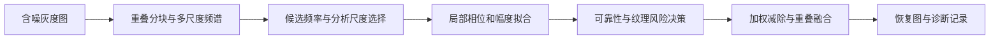
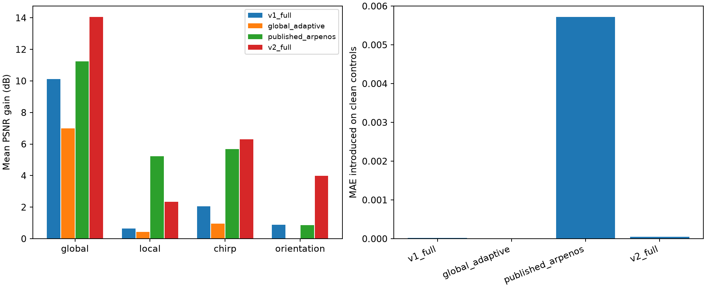

# 基于多尺度局部相位建模与保守决策的非平稳周期干扰抑制

[](https://github.com/dianxingaoshou/image-processing-periodic-denoising/actions/workflows/tests.yml)

一个图像处理课程研究项目，研究如何去除**只出现在局部、频率或方向随位置变化的周期条纹**，同时减少对干净区域和真实规则纹理的误改。

项目包含可运行的灰度图去噪算法、可控退化生成器、对照方法、模块消融及可复现实验。算法以局部周期残差拟合和加权减除为主，无需训练神经网络；少量运行参数在开发集校准。干净参考图、真实频率与干扰掩膜只用于校准和评价，不传给去噪器。

**当前结论：**局部相位建模对变化条纹有收益；安全权重解耦明显牺牲去噪量，尚未证明具有普遍纹理保护优势。本轮进一步修复块内部低频漏检、统一CLI默认配置，并实现可审计的新风险评分与离线增益诊断。新评分保留为显式实验分支，自然纹理误滤和窄条检出不足仍未解决。

快速入口：[运行自己的图片](#快速运行自己的图片) · [复现实验](#测试与实验复现) · [实验结果](#实验结果) · [目前的不足](#目前的不足) · [维护说明](MAINTENANCE.md)

## 项目做了什么



- **多尺度分析：**使用64、128、256像素分析窗口，频率统一为周期／像素，考虑正负共轭频率等价。默认每尺度最多提出3个候选，初筛后对一个候选进行精细拟合，再选择局部估计结果。
- **非平稳残差建模：**实现连续频率细化、二次相位和非负变幅模型，表示条纹频率、方向及幅度的局部变化。拟合改善与复杂度约束共同控制模型选择。
- **保守决策：**结合频峰证据、邻域与不同分析窗口的一致性、残差外推及局部结构风险；对近纯周期歧义输入允许不处理。分数是启发式可靠性，不是噪声概率。
- **完整复原：**复原块默认64×64、步长32，使用正端点窗口和归一化重叠融合覆盖边缘。分析尺度自适应，复原块大小保持固定。
- **系统实验：**实现全局陷波、固定尺度、历史版本及ARPENOS Python移植对照，记录质量指标、区域损伤、运行时间、失败案例、频率误差和处理覆盖率。

### 本轮按复核意见改了什么

| 要求 | 当前实现与验收 |
|---|---|
| 四角合格不能保证内部频率合格 | 检查每个离散像素中心的瞬时频率；内部过零、接近下限、合法低频／变频及上界均有回归用例。拒绝时残差归零，预测与 `final_sse` 同步回退背景模型。未声称约束整个连续矩形域。 |
| 文档推荐与CLI默认一致 | 默认加载P0耦合配置；解耦和新风险均显式选择。缺配置直接报错。 |
| 区分离线测试与数据验收 | `requires_bsds` 标记区分集成测试；缺参考数组时明确跳过，`--require-bsds` 则失败。CI按标记选择，不依赖测试名称。 |
| 检查安全评分是否对应实际收益 | 新增逐候选参考增益、误减除／过度保护、得分分箱及尾部损伤诊断；真实参考仅进入评价模块。 |
| 风险依据由剩余复杂度转向被移除结构 | 新增输入局部周期歧义、谐波支撑和减除前后结构损失；保持候选残差、资格及拟合权重 `q` 不变，便于归因。 |

本轮按建议选择**风险评分**作为一个主要改进。32窗口／32复原块与3×3非负空间包络尚未加入，局部支撑增强留待独立消融；不把风险评分变化说成候选召回提升。

## 版本与配置怎么选

| 版本／配置 | 内容 | 当前定位 |
|---|---|---|
| v1：`local_spectral.py` | 多尺度局部正弦估计与保守减除 | 历史基线 |
| v2：`optimized_denoiser.py` | 多候选初筛、连续频率、二次相位、变幅模型与风险评分 | 冻结研究基线，原入口保留 |
| 当前默认：`configs/v3_p0_coupled.json` | 原P0耦合参数，叠加本轮离散频率范围修复 | 自有图片默认入口；旧表不能直接充当当前修订的全量结果 |
| v3：`configs/v3_frozen.json` | 在同一P0残差上将拟合强度与安全上限解耦 | 实验配置，不作为已证实更优的v2替代 |
| 本轮实验：`configs/refined_risk.json` | 相同估计器与耦合增益，仅替换纹理风险评分 | 固定粗参数、未校准；显式启用，未升级为默认 |

v3将拟合权重记为 `q`，安全权重记为 `s`，二者在 `[0,1]` 内；不具减除资格的候选直接置零。两种组合为：

```text
耦合：g = min(alpha * q * s, 1)
解耦：g = min(alpha * q, 1) * s
```

解耦保证最终增益不超过安全权重，强度不能取消安全上限；它不保证安全评分正确识别了真实纹理。耦合与解耦对照使用相同残差和相同强度，便于判断组合顺序的作用。

P0还修复了固定隔点拟合在0.25周期／像素附近的退化，以及小图把相同有效窗口当作多个尺度支撑的问题。不同分析窗口仍有重叠，不视为统计独立样本。完整取舍见 [v3结论](results/v3/DECISION.md)。

新风险分支使用 `r = texture_penalty × L × max(A, H)`：`L` 为平滑梯度能量的正向损失比例，`A` 为输入局部少频带集中度映射，`H` 为候选基频二／三次谐波的输入能量支撑。它不再通过拟合解释率降低纹理风险；这些特征仍可能同时响应合法纹理和真实干扰，属于启发式歧义证据。

## 快速运行自己的图片

已验证环境为 **Windows PowerShell、Python 3.14**。以下命令中，`python` 应指向Python3.14；自有图像处理不需要先下载实验数据。

```powershell
git clone https://github.com/dianxingaoshou/image-processing-periodic-denoising.git
cd image-processing-periodic-denoising
python -m venv .venv
.\.venv\Scripts\python.exe -m pip install -r requirements-lock.txt

# 把input.png替换成实际图片路径
.\.venv\Scripts\python.exe filter_image_v3.py "input.png" --config configs/v3_p0_coupled.json --out results/own_image_v3
```

输入至少32×32像素。RGB／RGBA输入会按共享规则转换为浮点灰度；RGBA先与明确背景合成，当前输出是灰度恢复图。

| 输出文件 | 内容 |
|---|---|
| `restored.png` | 用于查看的8位恢复图 |
| `restored.npy` | 浮点恢复数组，避免PNG量化影响后续评价 |
| `diagnostics.npz` | 频率、尺度、强度及其他诊断数组 |
| `decisions.json` | 逐块决策、输入与配置来源、SHA256及预处理记录 |

没有参考图时，入口不会生成PSNR或SSIM。诊断频率图是块中心频率的重叠加权显示，不是完整逐像素频率场。

要检查解耦研究配置，请显式指定：

```powershell
.\.venv\Scripts\python.exe filter_image_v3.py "input.png" --config configs/v3_frozen.json --out results/own_image_v3_decoupled
```

检查本轮新风险评分：

```powershell
.\.venv\Scripts\python.exe filter_image_v3.py "input.png" --config configs/refined_risk.json --out results/own_image_structure_risk
```

**注意配置选择：**省略 `--config` 时默认加载 `configs/v3_p0_coupled.json`。配置文件缺失会报错；只有显式 `--use-default-config` 才允许使用未经校准的程序默认参数，这不等于推荐配置。

## 测试与实验复现

### 1. 不下载数据的数值测试

```powershell
.\.venv\Scripts\python.exe -m pytest -q tests original/periodic_notch_starter/test_demo.py -m "not requires_bsds"
```

本轮为 **152项通过、2项数据集成测试按标记排除**。GitHub Actions使用这条命令，仅检验数值与接口行为，不代表重新完成全部图像实验。也可直接运行 `pytest -q -rs`，缺少数据时会明确显示跳过原因。

### 2. 重建固定数据并运行完整测试

```powershell
.\.venv\Scripts\python.exe prepare_v3_data.py
.\.venv\Scripts\python.exe -m pytest -q tests original/periodic_notch_starter/test_demo.py --require-bsds
```

首次需要下载官方BSDS500归档及固定图片。脚本按已有清单和哈希重建210张BSDS参考、12张DTD参考及2个无配对实例，不重新选择审计图。本轮完整测试为 **154项通过**，记录在 [测试日志](results/refinement/tests.xml)；历史v3的104项记录保留在旧结果目录。

原图和NPY未纳入Git。无数据时跳过表示“未验证”，不是测试通过；完整验收必须使用 `--require-bsds`。

### 3. 复现本轮聚焦实验

```powershell
.\run_refinement.ps1
```

先重建固定输入，再依次执行开发诊断、冻结源码／配置、旧数据回归和一次独立检查，最后生成报告。默认写入新的 `results/refinement_reproduction/`，已有阶段结果会拒绝覆盖。脚本复用仓库中的 [固定协议](refinement_protocol.json)，不重新选择图像。

每阶段也可单独运行：`python refinement_experiments.py development --out results/my_study`；后续 `freeze`、`regression`、`check`、`report` 使用同一 `--out`。独立检查使用官方归档中4张未纳入旧清单的图片，文件名及SHA已固定，需保留 `data/source/images/test/`。

### 4. 复现历史v3实验

历史3900条主审计对应标签 `v3-validated-baseline`。当前源码已修订，旧快照校验失败是预期行为；要复现旧表，先建立该标签的独立工作目录，再安装依赖和重建数据：

```powershell
git worktree add ..\periodic-v3-baseline v3-validated-baseline
```

在该目录中运行：

```powershell
.\run_v3.ps1
```

脚本依次执行数据重建、测试、开发集校准、主审计、模型外与纹理验证、真实案例、强度曲线、边界检查、失败复核及报告生成。**它会重新校准并覆盖所在目录的配置与结果**。本轮未重跑旧3900条主审计，也没有更新旧冻结SHA掩盖源码差异。

冻结配置校验源码、数据生成、指标、基线、协议、审计ID及顺序，以及Python和数值库分发文件／二进制哈希。换环境可能不匹配旧快照；不要改SHA绕过检查，也不要把新环境运行直接标成旧冻结结果的精确复现。详细流程见 [MAINTENANCE.md](MAINTENANCE.md)。

## 实验结果

历史参数仅在30张开发图上选择，本轮风险阈值为固定粗参数，在其中8张图上诊断，未根据审计或DTD调参。同一原图的不同退化版本保持同一划分；历史三档幅度为0.06、0.12、0.18，同图同条件的频率、相位和包络保持配对。像素范围为 `[0,1]`，PSNR、SSIM明确使用 `data_range=1`，不对各结果分别拉伸对比度。

### 本轮：风险评分聚焦验证

开发8图×7条件、回归41个输入、独立4图×7条件，共125个输入。三种决策复用相同候选残差，比较4个固定强度，包含输入对照共1625行记录；强度采样与重叠块不是独立图像样本。

以下独立检查均为幅度0.12、强度2，4张图的PSNR均值。它是有限检查，不是大规模性能排名。

| 条件 | P0修复后耦合基线 | 新风险评分 |
|---|---:|---:|
| 全局定频 | 36.075 | 35.107 |
| 局部定频 | 36.807 | 37.711 |
| 频率渐变 | 26.834 | 27.200 |
| 方向变化 | 24.591 | 24.731 |
| 边缘窄条 | 35.430 | 35.353 |
| 不规则局部区域 | 36.313 | 36.596 |

**主要负面结果：**12张DTD未另加干扰对照的平均修改MAE由基线0.054074增至0.057386，最差20%均值由0.154785增至0.161340；两者均修改8/12张。新风险没有解决严重纹理误改，因此保留实验配置，CLI默认仍为耦合基线。

两个定位案例的风险排序有变化：合法 `banded` 纹理的安全权重中位数由0.930降至0.548，真实全局干扰案例由0.607升至0.792。但在强度2的耦合公式下，两者增益中位数仍为1，说明**评分变化不等于实际保护改善**。开发集与独立检查的整体得分／参考增益相关性也未改善，不能据此宣称评分已有效。

相近局部恢复质量比较中，独立检查只有6/12对具有非退化共同区间，其余明确保留为无法匹配；干净区误差差值很小，未据此声称实质性纹理保护。详细每图误差、退化比例、尾部损伤与安全分箱见 [本轮报告](results/refinement/RESULTS.md)、[取舍与失败分析](results/refinement/DECISION.md)、[独立检查原始记录](results/refinement/check/metrics.csv) 和 [离线收益分箱](results/refinement/check/gain_calibration.json)。


### v2：局部相位建模的效果

下表为v2审计的同批60张图，数值是三档强度下逐样本PSNR的均值，单位dB，越高越好。

| 条件 | 含噪输入 | v1完整方法 | ARPENOS Python移植 | v2完整方法 |
|---|---:|---:|---:|---:|
| 全局定频 | 22.43 | 32.55 | 33.69 | **36.49** |
| 局部定频 | 34.35 | 34.99 | **39.58** | 36.69 |
| 频率渐变 | 23.97 | 26.02 | 29.66 | **30.28** |
| 方向变化 | 23.54 | 24.44 | 24.41 | **27.53** |

这批结果支持v2对变化条纹的改进，但局部定频仍低于ARPENOS移植版。完整MSE、MAE、SSIM、配对区间和消融见 [v2结果](results/optimization_v2/RESULTS.md) 与 [原始汇总](results/optimization_v2/audit/summary.csv)。



### v3：数值修复与安全权重的代价

历史v3使用另一批60张图，并在同批输入上重跑冻结v2。两张表的测试图不同，不能跨表计算版本收益。它们在当轮作为审计数据，**在本轮复核后已成为回归与诊断材料**，不能再次宣称完全未参与设计。

| 条件 | 冻结v2 | v3 P0耦合对照 | v3解耦 |
|---|---:|---:|---:|
| 全局定频 PSNR dB | 36.70 | 36.50 | 29.89 |
| 局部定频 PSNR dB | 37.19 | 37.14 | 36.40 |
| 频率渐变 PSNR dB | 30.29 | 30.17 | 28.48 |
| 方向变化 PSNR dB | 27.51 | 27.24 | 26.61 |
| 无新增干扰，平均MAE ↓ | 0.00010773 | 0.00010528 | 0.00009009 |
| 无新增干扰，最差20%平均MAE ↓ | 0.00053863 | 0.00052642 | 0.00045046 |

尾部指标是60张图中MAE最高12张的均值。解耦相对P0耦合将尾部改动降低约 **14.4%**，同时全局定频PSNR下降 **6.61 dB**。因此，安全上限机制修复不能直接当作去噪性能升级。

比较相近去噪量时，仅在双方共同区间内对采样曲线插值，并保留无法匹配的案例。局部干扰曲线和DTD配对探索没有支持解耦相对耦合具有普遍更优的选择性保护；相对关闭保护则损伤较低。插值点不是独立样本。


### 验证范围与结果位置

| 实验 | 输入规模 | 方法结果记录 | 回答的问题 |
|---|---|---:|---|
| v3主审计 | 60图×四类×三强度，加60个无新增干扰对照 | 3900 | 正确性修复、耦合／解耦与关闭保护的权衡 |
| 模型外与位置压力测试 | 固定20图，三次相位、随机相位、四角、边缘窄带、不规则区域 | 500 | 偏离二次相位模型、偏置局部干扰时的表现 |
| DTD纹理配对 | 固定12图，未另加干扰及全局／渐变干扰 | 180 | 是否既保留纹理又能去掉新增干扰 |
| 无参考实例 | OpenCV周期干扰图、作者canvas案例 | 仅固定配置定性展示 | 合成模型之外的可见行为 |

v3主数据清单共210张BSDS图：30开发、120过往验证回归、60当轮审计。频率误差在块中心评价；候选覆盖率、实际处理覆盖率与干净区误处理率的分母包含缺失和拒绝的块，这些是块中心比例，不是像素覆盖率。PSNR均值、MSE均值、区域损伤和程序异常分别记录。

- [v3完整结果](results/v3/RESULTS.md)、[原始汇总](results/v3/audit/summary.csv)、[本轮取舍](results/v3/DECISION.md)
- [模型外结果](results/v3/stress/summary.csv)、[DTD结果](results/v3/textures/summary.csv)
- [DTD配对后验探索](results/v3/texture_tradeoff/EXPLORATORY.md)、[完整性与复现核验](results/v3/verification.json)

## 目前的不足

1. **真实纹理仍会误滤。** 在12张定向DTD子集上，冻结解耦配置的全局加噪恢复MSE为0.008479，高于输入0.006679；渐变加噪为0.008404，高于输入0.004702，仍有净损伤。减少未加噪照片的改动量，不足以证明纹理保护成功。
2. **安全评分仍是启发式。** 它不能保证区分真实周期纹理与附加干扰；同样像素可以有不同真实解释。保守拒绝也可能留下平滑背景上的真实条纹。
   本轮新风险改善了两个定位案例的分数排序，却没有改善整体收益排序或DTD尾部损伤；耦合公式饱和还可能抵消风险权重的影响。
3. **模型表达与鲁棒性有限。** 每块主要估计一个周期分量，多候选不等于任意多频同时分离。非二次相位、弱局部条纹及突变边界仍可能残留或误估。
4. **数据证据有限。** DTD只有12张定向压力图，不能代表整个数据集；“无新增干扰”不保证照片物理上完全无噪声。真实实例只有2个，没有配对干净参考，不报告参考PSNR或SSIM。
5. **可选重排尚未证明稳定收益。** 前2候选精拟合和邻块重叠残差重排仅有小规模开发诊断，默认关闭。候选提出仍读完整窗口，留出只隔离精细参数拟合，不是完全独立交叉验证。
6. **已发表方法仅完成源码指导移植。** ARPENOS使用IRLS/MAD替代MATLAB `robustfit`，仅包含 `reg=0` 路径；未完成MATLAB／Octave原版逐输入数值核验，不冒称原论文指标复现。
7. **当前是灰度研究原型。** 不提供彩色联合复原；运行时间为本机单次测量，不能据此建立严格速度排名。
8. **局部空间支撑仍不足。** 现有仿射幅度不能准确表达所有窄条／不规则边界；本轮风险分支未改变候选提出和包络，32窗口及非负网格包络仍待独立验证。

## 代码与产物导航

| 路径 | 作用 |
|---|---|
| [denoiser_v3.py](denoiser_v3.py) | 组合估计器与保护模块，提供 `prepare / restore / denoise` |
| [local_estimation_v3.py](local_estimation_v3.py) | 候选、有效窗口、相位／幅度拟合及可选重排 |
| [texture_guard_v3.py](texture_guard_v3.py) | 拟合／安全权重、候选资格与纹理风险 |
| [image_io_v3.py](image_io_v3.py)、[filter_image_v3.py](filter_image_v3.py) | 共享预处理与单图入口 |
| [validation_data_v3.py](validation_data_v3.py)、[prepare_v3_data.py](prepare_v3_data.py) | 固定数据、退化生成与输入重建 |
| [v3_experiments.py](v3_experiments.py)、[v3_evidence.py](v3_evidence.py) | 校准、批量实验、覆盖评价与匹配去噪证据 |
| [reproducibility_v3.py](reproducibility_v3.py)、[v3_verify.py](v3_verify.py) | 源码／依赖冻结及产物核验 |
| [gain_diagnostics.py](gain_diagnostics.py)、[refinement_experiments.py](refinement_experiments.py) | 离线参考增益、风险分箱、聚焦配对实验及独立检查 |
| [tests/](tests/)、[configs/](configs/) | 数值边界测试与已测配置 |
| [results/](results/)、[data/v3_manifest.json](data/v3_manifest.json) | 原始CSV、报告、核验记录及数据清单 |
| [original/](original/)、[third_party/](third_party/) | 起步原型、外部源码与来源说明 |

Git保存源码、测试、固定清单和数值证据；原图、运行环境、浮点数组及密集逐图诊断在本地重建。仓库中的代表图位于 [docs/figures/](docs/figures/)。修改、分支提交和完整复现注意事项见 [MAINTENANCE.md](MAINTENANCE.md)。

## 数据来源与使用条件

BSDS500、DTD、OpenCV和ARPENOS的来源、引用及哈希保存在数据清单与各自provenance文件中。ARPENOS作者代码及相应移植限学术研究使用；仓库公开不改变第三方材料的许可条件。详见 [THIRD_PARTY_NOTICES.md](THIRD_PARTY_NOTICES.md)、[文献来源](literature_sources.json) 和 [ARPENOS移植差异](third_party/arpenos/PORT_NOTES.txt)。
