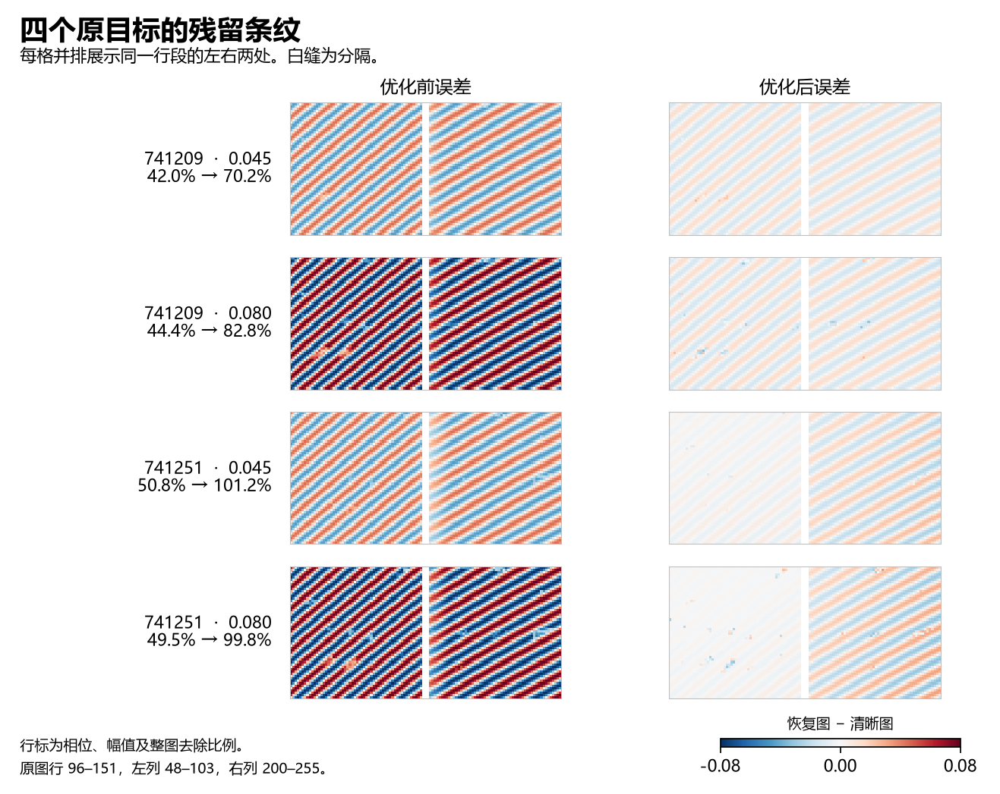

# 保留织物纹理的周期条纹去除

输入一张照片，程序估计叠加条纹的位置、频率和相位，再从灰度亮度中减去有证据支持的波形。它可以处理全图条纹、部分局部窄条，以及部分随位置变频或转向的干扰。没有足够证据的位置保留输入。整套算法使用频谱分析与局部波形拟合，无需训练。

## 处理自己的图片

在仓库根目录安装依赖。以下命令适用于 Windows PowerShell，环境为 Python 3.14。

```powershell
python -m venv .venv
.\.venv\Scripts\python.exe -m pip install -r requirements-lock.txt
.\.venv\Scripts\python.exe filter_project.py input.png --out results/own_image
```

Linux 或 macOS 可使用 `.venv/bin/python`。输入最小尺寸为 32×32。RGB 会转换为亮度，RGBA 先合成背景。默认使用当前完整算法，同一命令加 `--collision` 可以运行本轮修改前的版本。只处理自己的图片时无需下载实验照片。

| 输出 | 内容 |
|---|---|
| `restored.png`、`restored.npy` | 便于查看的灰度图与未量化的浮点恢复结果 |
| `diagnostics.npz` | 实际减去的信号 `residual`、允许修改的位置 `support_mask`，以及所选路径提供的中间数组 |
| `decisions.json` | 处理路径、接受或拒绝的原因、输入与配置指纹 |

## 工作流程

1. 检查全图周期规律和窄条轮廓。局部窄条沿行或列拟合，参考相邻未污染区域，恢复限定在估计支撑内。
2. 对范围较大的干扰，用重叠窗口估计局部频率、相位和幅值，检查相邻窗口对共同像素的预测是否一致，再加权重建。
3. 对编织纹理，利用重复频峰推算织纹格点，检查候选条纹会不会与实测主峰碰撞。拟处理的渐变波形还须通过亮度、局部相位与截幅端点的核查。
4. 记录实际减除量和处理依据。清晰原图、合成参数及真实污染区域只用于实验评分。

## 实验结果

同一张 `woven_0083` 织物照片上，旧版在相位 741209 和 741251 的两档幅值下都留下了两条明显的斜纹。原算法从带外区域同时估计频率和曲率，有效数据合计仅相当于 41.5–43.5 列。三个输入的角点频率偏移分别达到 1.124、0.514、0.728 个 FFT 格，超过半格限制。741251 的高幅档偏移 0.408 格，真正失败的是右带下半部的亮度波形，误差 0.502 超过门限 0.45，而截幅位置的相位核查通过。离线移去已知织纹后重拟，这四次漂移都降至 0.18 格以内。[逐案诊断](results/phase_refit/diagnosis.md)

新版从截幅像素估计扫频的弯曲程度，再用两段带外亮度估计频率、幅值和相位。在每条带的上下半部，另外估计定频织纹对亮度的贡献。只有能分清扫频和定频织纹，且留出像素的截幅方向也吻合，才减去带外预测的扫频。推理只读取观测图。

| 相位 | 幅值 | 整图条纹去除比例（上版 → 本版） | 左／右残留区的均方误差降幅 | 第 5 峰误差（×10⁻⁹） | 第 6 峰误差（×10⁻⁹） |
|---|---:|---:|---:|---:|---:|
| 741209 | 0.045 | 42.03% → 70.24% | 89.4%／90.1% | 19.058 → 8.681 | 5.858 → 1.062 |
| 741209 | 0.080 | 44.41% → 82.80% | 96.3%／96.0% | 80.047 → 22.348 | 27.769 → 6.865 |
| 741251 | 0.045 | 50.84% → 101.24% | 97.0%／76.7% | 16.801 → 14.260 | 7.493 → 2.354 |
| 741251 | 0.080 | 49.49% → 99.79% | 99.2%／88.7% | 86.925 → 32.362 | 38.082 → 2.887 |

去除比例是实际减除量在已知新增条纹上的投影。超过 100% 表示沿该方向过减。四例均达到事先约定的改善幅度，两处固定条带的像素误差和两组织纹主峰误差均下降。将两版减除量缩至相同去除比例后，8 项主峰额外误差也全部下降。`741251` 的右带仍可看到淡斜纹，即使整图去除比例接近 100%，也要分别看左右区域。

冻结后换三个新相位，各测两档。其中五例原已去掉 97%–100%，本版输出与上版逐像素相同。`638927` 的低幅档从 54.31% 提高至 110.66%，有明显过减，两处残留区及第 5、6 峰的误差仍低于上版。这些对照只覆盖同一张织物。[新相位误差图](docs/figures/phase-refit-holdout.png)

160 个历史输入有 6 个整图误差下降，其余 154 个输出逐像素相同。原先 9 例结果一致，33 个干净对照均为零改动。69022 的 8／16 像素窄条和强度对照共 10 组，恢复图、残差、支撑区及路径均相同，相邻 16 像素干净区和全部干净区的均方误差均为 0。另加局部定频细纹的 8 项配对中，保留了 99.2%–99.9% 的已知细纹增量，12 项干净条带对照均为零改动。若把同一观测中与干扰完全同幅、同频、同相的局部波形解释为真实织纹，则 8 项带内误差全部上升。这是单图分离的边界。[逐峰误差](results/phase_refit/per_peak.csv) · [窄条核对](results/phase_refit/parity.csv) · [同观测不同真值](results/phase_refit/alternative_references.csv)



本机预热后串行交替运行两版完整入口，排除图像加载、合成和评分。四个目标合计耗时中位数为 **5.789 → 5.685 秒**，四轮配对均较快，配对缩短幅度中位数为 1.79%。预登记的七个输入合计 6.776 → 6.672 秒，加入六个新相位后的 13 个输入合计 15.264 → 15.001 秒。单看 69022 底边两档合计 74.07 → 74.38 毫秒，各轮有快有慢。[各输入原始耗时](results/phase_refit/timing.csv) · [配对汇总与环境](results/phase_refit/timing.json)

补测高幅 741209 的局部真纹对照。左侧叠加真实细纹后，旧版拒绝处理，新版需从截幅位置重新搜索条纹，单图耗时 **1.293 → 1.320 秒**，多约 27 毫秒。右侧叠加时可沿用原候选，耗时 1.413 → 1.378 秒。只在左带外加噪时两版输出相同，耗时 0.942 → 0.947 秒。[补充计时及输入输出指纹](results/phase_refit/timing_controls.json)

[同图两档幅值、新相位和织纹主峰的逐例报告](results/phase_refit/RESULTS.md) · [运行耗时](results/phase_refit/timing.json) · [复现步骤](MAINTENANCE.md)

## 目录

要在本地查看原织物、含噪及恢复灰度图，先执行 `python experiments/run.py prepare` 获取并校验研究数据，再执行 `python experiments/run.py figures --results results/phase_refit --out figures`。绘图程序只重放需要展示的十个输入，逐项核对清晰图、观测图和两版输出的哈希，生成的 PNG 位于 `.study/figures/`。

| 路径 | 维护内容 |
|---|---|
| [filter_project.py](filter_project.py) | 单图命令行入口 |
| [src/](src/) | 推理代码及两份默认配置，当前 API 为 `project_phase.denoise` |
| [experiments/](experiments/) | 本轮诊断、配对评估、绘图、计时和必要的历史评分基线 |
| [results/phase_refit/](results/phase_refit/) | 本轮协议、逐图与逐峰原始数值、窄条回归和耗时 |
| [tests/](tests/) | 发布版的推理、边界、输入输出与基线测试 |
| [data/](data/) · [third_party/](third_party/) | 外部照片清单、来源及已发表方法的引用和使用条件 |

在仓库根目录运行 `python -m pytest -q` 执行测试。运行 `python experiments/run.py check` 核对冻结源码与正式结果。历史布局与更早实验可以从 [研究快照](https://github.com/dianxingaoshou/image-processing-periodic-denoising/tree/1740a94) 查阅。数据与第三方代码使用条件见 [来源说明](THIRD_PARTY_NOTICES.md)。
